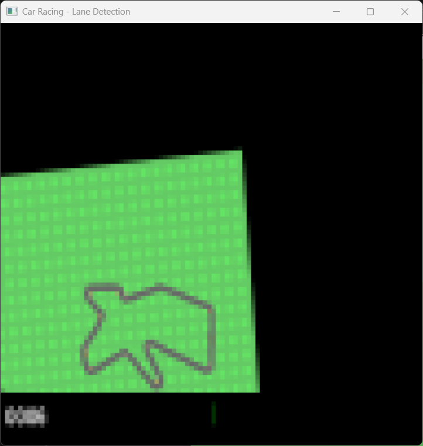

# Abschlussprojekt: Autonomer Rennwagen

Dieses "Framework" enthält eine grundlegende Struktur für die Umsetzung einer modularen Pipeline für die Gymnasium Car Racing Simulation ([link](https://gymnasium.farama.org/environments/box2d/car_racing/)).

## 0. Requirements

- Python >3.12

## 1. Installation

Wir empfehlen die Pakete in einem virtuellen environment zu installieren. Für Details, siehe die Einführung in Python. 

1. Installieren aller python Pakete: `pip install "gymnasium[box2d]" numpy matplotlib scipy opencv-python`
2. In den Source Ordner wechseln `cd <working-dir>`
3. Testen der Installation: `python test_installation.py`. Danach sollte sich die Simulation öffnen und das Fahrzeug zufällig bewegen.

## 2. Dateistruktur

Das Projekt ist wie folgt zu strukturieren:

```python
working-dir/
| - data/ # Bilder zu getesteten Varianten der Spurerkennung und Pfadplanung
| - docs/ # Aufgabenstellung, Bewertung, Abschlusspräsentation, Quellen
| - .gitignore # Definition von Dateien, die nicht von git getrackt werden sollen
| - car.py # Beschreibt das Fahrzeug und enthält die gesamte Pipeline
| - CHANGES.md # Wichtige Designentscheidungen
| - env_wrapper.py # Wrapper für die Gymnasium Car Racing Simulation
| - FINDINGS.md # Erkenntnisse über Simulation, Fahrzeug und Kamera
| - geometry.py # Umrechnung Pixel -> Fahrzeugkoordinaten, Pfad und Krümmung für die Regler
| - input_controller.py # Manuelle Steuerung des Fahrzeugs
| - lane_detection.py # Modul zur Spurerkennung
| - lateral_control.py # Modul zur Querregelung
| - longitudinal_control.py # Modul zur Längsregelung
| - main.py # Hauptdatei, die die Pipeline über 5 Iterationen ausführt
| - path_planning.py # Modul zur Pfadplanung
| - pyproject.toml # Abhängigkeiten
| - README.md # Diese Datei
| - test_installation.py # Testet die Installation
| - test_lane_detection.py # Testet die Spurerkennung
| - test_lateral_control.py # Testet die Querregelung
| - test_longitudinal_control.py # Testet die Längsregelung
| - test_path_planning.py # Testet die Pfadplanung
| - test_pipeline.py # Testet die gesamte Pipeline
| - TODO.md # Aufgabenliste
```

## 3. Ausführung

```
python main.py
```

Die test Dateien können mit `python <test-file>.py` ausgeführt werden. Die Simulation wird sich öffnen und das Fahrzeug wird sich entsprechend der Pipeline bewegen. Um das Endergebnis zu simulieren, kann die `main.py` Datei ausgeführt werden. Sie führt die Pipeline über 50 Iterationen aus und berechnet den durchschnittlichen Score.

## 4. Hinweise

Die Dateien `main.py`, `env_wrapper.py` und `input_controller.py` dürfen nicht verändert werden, damit die Ergebnisse vergleichbar bleiben. Alle anderen Dateien können beliebig verändert werden.

## 5. Gemeinsame Geometrie (`geometry.py`)

Beide Regler rechnen nicht in Pixeln, sondern in Einheiten der Simulation, in einem Fahrzeugkoordinatensystem mit Ursprung im Fahrzeug.

- **Skalierung**: Das 1000x800 Fenster wird auf 96x96 Pixel verkleinert. Quer entspricht eine Einheit 1,56 px, längs 1,94 px. Winkel und Krümmungen direkt in Pixeln wären verzerrt.
- **Zoom am Start**: Die Kamera zoomt in der ersten Sekunde ein. Der Zoom pro Frame ist bekannt (`camera_zoom`) und wird herausgerechnet. Bis zum halben Zoom ist ein Pixel zu grob, solange ignorieren die Regler den Pfad.

## 6. Spurerkennung (`lane_detection.py`)

Die Spurerkennung nutzt einen Farbfilter um die Straße von dem Rasen zu unterscheiden, dies ergibt eine Binäre Maske (Straße und nicht Straße)

Damit die Straße auch bei `domain_randomize=True` erkannt wird, wird ein Streifen Straße vor dem Auto genutzt um die Farbe der Straße zu ermitteln.

Mithilfe zweier 1D Convolutions werden sowohl horizontale wie auch vertikale Kanten erkannt, welche in eine Maske vereint werden.

Um aus der Maske die Fahrbahnbegrenzungen werden zwei Walker links und rechts neben dem Auto gestartet. Dies können auch vollständige Kurven Laufen.


<details>
<summary>Verworfene Ideen</summary>

- Klassische Kantenerkennung mittels Grau-Filter
- Rekonstruktion der Track mittels dem Rausgezoomten Erstem Frame
  - Die Globale Übersicht war nicht immer Vollständig sichtbar.
  - Sehr Rechenintensiv um aus dem "bixelbrei" eine geordnete Rennstrecke zu bekommen (Einmal ~60ms)
  - Umsetzung nicht beendet
  - 

</details>
<br>

> Wichtig! Da in `main.py` mehrere Durchläufe hintereinander ablaufen, ohne LaneDetection neu zu Initialisieren, wird der Geschwindigkeitsbalken in der UI genutzt um den Start einer neuen Strecke zu Signalisieren. Danach wird wegen dem Zoom noch 25frames (0.5s) gewartet bis die Straßenfarbe neu Erkannt wird.

## 7. Pfadplanung (`path_planning.py`)

Pfadplanung implementiert eine Mittelspur mittels `nearest point on other lane`


<details>
<summary>Verworfene Ideen</summary>

- Mittelspur-Erkennung mittels Maximalen Kreisen 
  - Quelle: [Lane Centerline Extraction Based on Surveyed Boundaries](https://pmc.ncbi.nlm.nih.gov/articles/PMC12031461/pdf/sensors-25-02571.pdf)
  - Wurde verworfen, da es nicht Echtzeitfähig war (Auf Thinkpad X13 getestet)
- Optimierung der Mittelspur auf die Maximierung der Geschwindigkeit (Racing Lines)
  - Idee: Ermittlung der größten Kreise durch eine Kurve
  - Idee: Anpassung der Mittelspur auf Maximierung der Geschwindigkeit
    - Implementierung zuerst sehr Rechenintensiv und nicht Echtzeitfähig
    - Nach Änderung der Parameter auf Echtzeitfähigkeit keine Verbesserung zur Mittelspur

</details>

## 8. Querregelung (`lateral_control.py`)

Die Querregelung nutzt den **Stanley-Regler** an der Vorderachse:

$$
\delta = k_\psi \cdot \psi
  + \arctan\left(\frac{k \cdot e}{k_\mathrm{soft} + v}\right)
  + k_d \cdot \frac{d\psi}{dt}
$$

$$
k_\psi = \frac{L}{L + v \cdot \tau}
$$

| Parameter | Standard | Bedeutung |
| --------- | -------- | --------- |
| `gain` | 1.0 | k, Gewicht der Querabweichung e (1/s) |
| `softening` | 1.0 | k_soft, begrenzt die Verstärkung beim Anfahren (Einheiten/s) |
| `heading_time` | 0.1 | tau, kürzeste Zeit, in der der Kurswinkelfehler psi ausgeregelt wird (s) |
| `damping` | 0.02 | k_d, D-Anteil auf psi (s) |
| `damping_filter` | 0.1 | Zeitkonstante des Tiefpasses auf den D-Anteil (s) |
| `preview` | 12.0 | Sehnenlänge, über die psi gemessen wird (Einheiten) |

Erweiterungen gegenüber dem Standard-Stanley:

- **Kurswinkel über eine Sehne**: Statt der Tangente am Lotfußpunkt wird die Richtung zum Pfadpunkt 12 Einheiten weiter genommen. Das glättet das Pixelrauschen und schneidet Kurven leicht an, dadurch sind höhere Kurvengeschwindigkeiten möglich.
- **Kurswinkel-Verstärkung sinkt mit dem Tempo**: Lenkt das Auto um $\psi$, dreht es sich mit $v \cdot \psi / L$. Beim klassischen Stanley ($k_\psi = 1$) wäre der Kurswinkel bei 80 Einheiten/s in 0,04 s ausgeregelt, schneller als die Verzögerung im Regelkreis (ein Frame Kamera, Lenkmotor). Das Auto schwingt dann mit den Frames hin und her. Mit $k_\psi = \frac{L}{L + v \cdot \tau}$ dauert das Ausregeln $\tau + \frac{L}{v}$, also nie unter 0,1 s. Beim Anfahren bleibt $k_\psi$ nahe 1.
- **Dämpfung (D-Anteil)**: Die Änderung des Kurswinkelfehlers entspricht der Differenz aus Gierrate des Pfads und des Autos. Der Term dämpft das Aufschwingen bei hohem Tempo. Ein Tiefpass (0,1 s) filtert das Pixelrauschen heraus, ungefiltert hat der D-Anteil das Rauschen der Spurerkennung verstärkt.
- **Ausgabe in rad**: Die Lenkaktion ist in der Simulation der Soll-Radwinkel in rad (Anschlag ±0,4 rad). Der Regler gibt ihn deshalb direkt aus.
- **Pfadaussetzer**: Ohne Pfad klingt der letzte Lenkwinkel pro Frame mit Faktor 0,9 ab. Kurze Aussetzer werden überbrückt, ohne dass das Auto dauerhaft eingelenkt bleibt.

Als Alternative wurde Pure Pursuit umgesetzt und verglichen. Stanley war robuster, Pure Pursuit ist deshalb nicht mehr im Code.

## 9. Längsregelung (`longitudinal_control.py`)

**Zielgeschwindigkeit** aus dem sichtbaren Pfad:

1. Kurvengeschwindigkeit an jedem Pfadpunkt: $v = \sqrt{\frac{a_\mathrm{quer}}{\kappa}}$.
2. Bremsweg: Ein Punkt im Abstand $s$ erlaubt $\sqrt{v_\mathrm{kurve}^2 + 2 \cdot a_\mathrm{brems} \cdot s}$. Das Minimum über alle Punkte ist die Zielgeschwindigkeit.
3. Sichtweite: Hinter dem Pfadende kann eine Haarnadelkurve kommen, bis dorthin muss das Auto auf `min_speed` bremsen können. Weniger Sicht bedeutet automatisch langsamer.

Das Krümmungsfenster von ±8 Einheiten lässt kurze Kurven flacher wirken als lange. Das passt zum Fahrverhalten, kurze Kurven schneidet das Auto stärker an. Mit ±4 sinkt der Score auf 924,0 (Haarnadel 913,3).

**PID-Regler**: Der Ausgang ist eine Soll-Beschleunigung. Über gemessene Kennwerte (Vollgas $\approx 44\,\mathrm{Einheiten/s^2}$, Bremse $\approx 300 \cdot b\,\mathrm{Einheiten/s^2}$) wird sie in Gas oder Bremse umgerechnet.

- D-Anteil auf die gemessene Beschleunigung statt auf den Fehler, Sprünge der Zielgeschwindigkeit erzeugen so keinen Stoß.
- Anti-Windup: Integriert wird nur, solange der Ausgang nicht in der Begrenzung steckt.
- Kammscher Kreis: Die Querbeschleunigung wird aus Lenkwinkel und Tempo geschätzt $\frac{v^2 \cdot \tan(\delta)}{L}$, nur die restliche Haftung bekommt das Gas. Ohne diese Begrenzung brechen die Hinterräder in Kurven aus.
- Bremse höchstens 0,7, darüber blockieren die Räder nach einigen Schritten.

| Parameter | Standard | Bedeutung |
| --------- | -------- | --------- |
| `kp`, `ki`, `kd` | 8.0, 1.0, 0.05 | PID auf die Soll-Beschleunigung |
| `max_speed`, `min_speed` | 100, 30 | Grenzen der Zielgeschwindigkeit (Einheiten/s) |
| `lateral_accel` | 220 | erlaubte Querbeschleunigung auf der Mittellinie (Einheiten/s²) |
| `brake_accel` | 150 | eingeplante Verzögerung vor Kurven (Einheiten/s²) |
| `curvature_window` | 8 | Punkte links und rechts für die Krümmung |
| `max_brake` | 0.7 | maximaler Bremswert |

`lateral_accel` liegt an der Haftgrenze von 219 Einheiten/s². 240 war auf kurzen Kurven minimal schneller, weil das Auto sie anschneidet. In langen Haarnadeln geht das aber nicht: Dort rutschte das Auto nach außen, verlor die Strecke und drehte sich.

## 10. Benchmarking (`benchmark.py`)

Das Benchmarking erlaubt das Testen nach Score und die überprüfung nach Laufzeit. Dieses Script arbeitet mit mehreren Workern, wodurch es parallel mehrere Seeds testen kann.

Es gibt mehrere Modi:

```
python benchmark.py --mode pipeline   # full pipeline
python benchmark.py --mode gt         # controllers on the ground truth centerline
python benchmark.py --seeds 693592 373468   # specific seeds
```

Ein Durchlauf kann dann so aussehen:

```
$ python benchmark.py --mode pipeline --seeds
seed 002006  score  936.40  steps  636  lap yes  tiles 100.0%  v  73.0  cte 1.07/ 4.96  offroad   0
seed 002730  score  926.70  steps  733  lap yes  tiles 100.0%  v  68.0  cte 1.68/ 4.76  offroad   0
...
seed 197453  score  928.80  steps  712  lap yes  tiles 100.0%  v  68.1  cte 1.37/ 4.70  offroad   0
---------------------------
 avg score:   926.40  (std 6.41)
 min / max:   914.90 / 937.00
 low 5 avg:   916.84
 laps:        28 / 28
 mean speed:  70.9
 mean cte:    1.39
 offroad:     0 steps
---------------------------
 runtime per step in ms:       p50     p95     p99     max
 lane_detection               1.500   2.529   3.499  13.362
 path_planning                2.623   4.262   5.310  26.935
 lateral_control              0.384   0.595   0.763   9.903
 longitudinal_control         0.306   0.479   0.641   8.051
 total                        4.893   7.626   9.705  29.460
 budget at 50 FPS: 20 ms
---------------------------
```

Benchmarking kann auch mittels `main.py` durchgeführt werden:

```
$ python main.py --domain_randomize
episode: 00     seed: 582400     reward: 931.90     avg 5 reward: 931.90     avg reward: 931.90     
episode: 01     seed: 495130     reward: 932.20     avg 5 reward: 932.05     avg reward: 932.05
...
episode: 49     seed: 715788     reward: 931.80     avg 5 reward: 926.88     avg reward: 927.68     
---------------------------
 avg score: 927.682000
 std diff:  8.399350
 max score: 944.100000
 min score: 911.300000
---------------------------
 top 5 avg score: 941.980000
 low 5 avg score: 914.400000
---------------------------
```